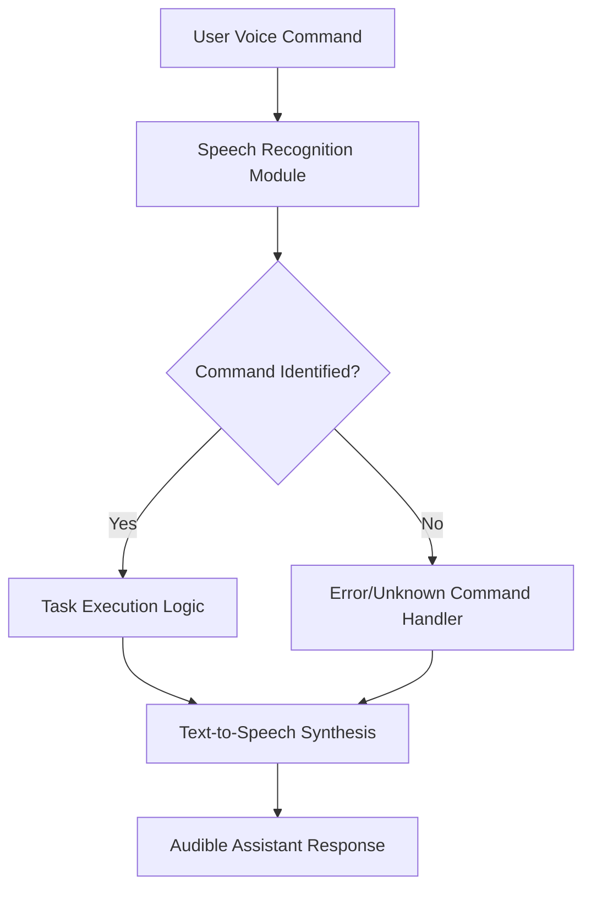

# 🚀 Py-Assistant

## Short Description
Unleash the true potential of your desktop with **Py-Assistant**, a sophisticated and intelligent personal assistant crafted entirely in Python. Designed for unparalleled efficiency and ease of use, Py-Assistant transforms your daily interactions with your computer into a seamless, voice-controlled experience, automating mundane tasks and delivering instant information right when you need it.

## ✨ Key Features
*   **Intelligent Voice Command Recognition:** Interact naturally using your voice, making your computer experience more intuitive.
*   **Automated Task Execution:** Effortlessly open applications, navigate the web, or perform system commands without touching your keyboard.
*   **Instant Information Retrieval:** Query the web for weather, news, facts, or definitions and receive immediate vocal feedback.
*   **Lightweight & Cross-Platform:** Built with core Python, ensuring compatibility and minimal overhead across various operating systems.
*   **Modular & Extensible Core:** A straightforward `main.py` structure allows developers to easily understand, modify, and extend its capabilities.

## Who is this for?
*   **Productivity Enthusiasts:** Individuals looking to enhance their daily workflow through hands-free computing and automation.
*   **Python Developers:** Seeking a robust foundation or inspiration for building their own voice-controlled applications and intelligent agents.
*   **Students & Hobbyists:** Anyone interested in exploring the practical applications of AI, speech recognition, and system automation with Python.

## Technology Stack & Architecture
Py-Assistant leverages the power and versatility of Python 3.x to deliver its intelligent capabilities. While core libraries for speech recognition, text-to-speech, and system interaction are typically employed, the project maintains a lean and focused dependency footprint.

**Core Technologies:**
*   **Python 3.x:** The sole programming language powering the assistant.
*   **Likely Integrations (inferred):** Libraries such as `SpeechRecognition` for audio input processing, `pyttsx3` for text-to-speech output, and standard Python modules (`os`, `webbrowser`, `requests`) for system and web interactions.

**Architecture:**
The project follows a simple, monolithic application architecture centered around the `main.py` script. This design ensures all functionalities are tightly integrated, offering a cohesive and responsive user experience.

## 📊 Architecture & Database Schema



## ⚡ Quick Start Guide
Get Py-Assistant up and running on your system in minutes!

1.  **Prerequisites:**
    Ensure you have Python 3.x installed on your system.

2.  **Download the Project:**
    Clone the repository to your local machine:
    ```bash
    git clone https://github.com/ManavPatni/Py-Assistant.git
    cd Py-Assistant
    ```

3.  **Run the Assistant:**
    Execute the main script:
    ```bash
    python main.py
    ```
    *Note: Depending on your system and desired features, you may need to install additional Python libraries manually (e.g., `pip install SpeechRecognition pyttsx3`).*