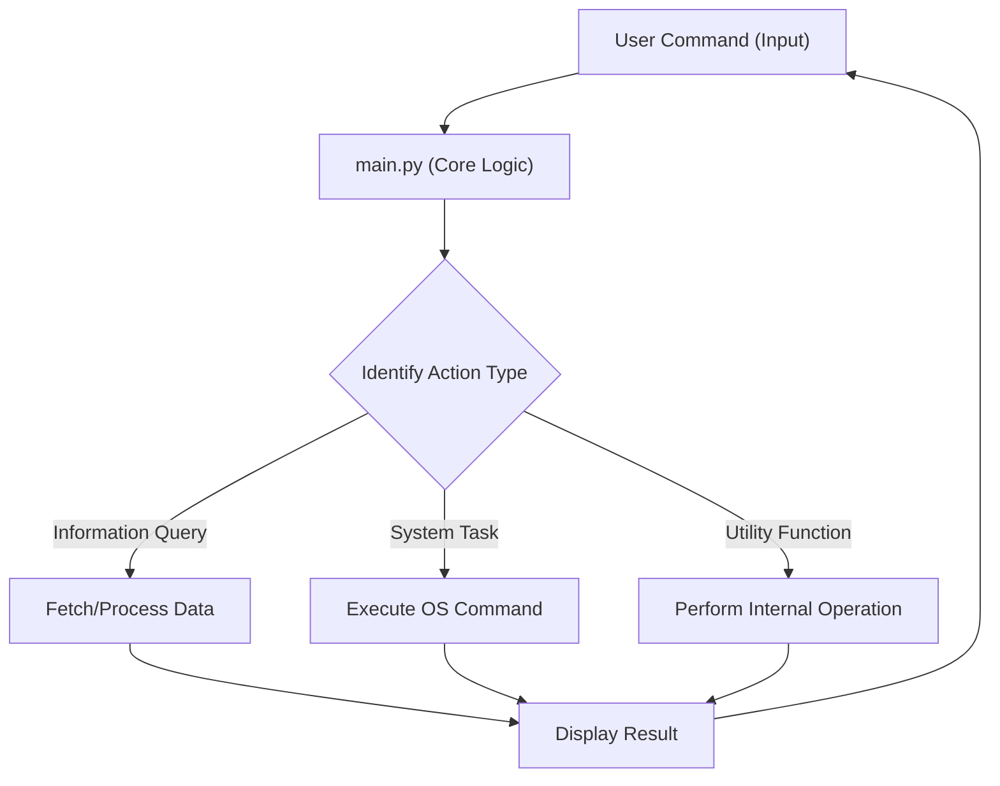

# 🚀 Py-Assistant

## Short Description
Py-Assistant is a versatile and intelligent personal assistant built entirely with Python. Designed for efficiency and convenience, it empowers users to automate daily tasks, retrieve information, and interact with their system through a powerful, script-driven interface. Say goodbye to manual drudgery and hello to streamlined productivity with your new Python-powered companion!

## ✨ Key Features
*   **Intelligent Command Processing:** Understands and executes a variety of user commands.
*   **Task Automation:** Automate repetitive actions and system operations.
*   **Information Retrieval:** Quickly fetch data, news, or specific information.
*   **Lightweight & Efficient:** A single-file application, easy to deploy and run.
*   **Highly Extensible:** Built on Python, making it simple to add new functionalities and custom commands.

## Who is this for?
*   **Developers:** Looking for a foundational Python project to learn automation, system interaction, or expand into AI/NLP.
*   **Power Users:** Seeking to automate routine tasks on their personal computer.
*   **Anyone:** Who wants to dip their toes into creating a custom digital assistant without complex setups.
*   **Python Enthusiasts:** Interested in a practical application of core Python capabilities.

## Technology Stack & Architecture
**Technology Stack:**
*   **Python 3.x:** The sole programming language powering the assistant.

**Architecture:**
Py-Assistant follows a straightforward, single-file application architecture, emphasizing simplicity and direct execution. All core logic resides within `main.py`, making it highly portable and easy to understand.

## 📊 Architecture & Database Schema
Below is a simplified architectural overview illustrating how Py-Assistant processes user interactions. As a single-file utility, it prioritizes direct execution over complex database structures, meaning no external database schema is utilized.



## ⚡ Quick Start Guide
Getting Py-Assistant up and running is incredibly simple!

1.  **Clone the Repository (or download `main.py`):**
    ```bash
    git clone https://github.com/ManavPatni/Py-Assistant.git
    cd Py-Assistant
    ```

2.  **Ensure Python is Installed:**
    Py-Assistant requires Python 3.x. If you don't have it, download and install it from [python.org](https://www.python.org/downloads/).

3.  **Run the Assistant:**
    Execute the `main.py` script directly from your terminal:
    ```bash
    python main.py
    ```
    Your Py-Assistant is now active and ready to receive commands!